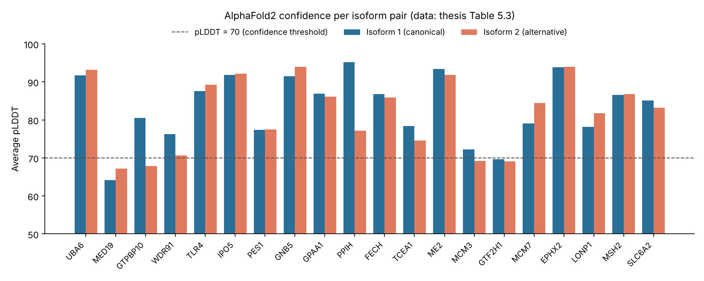
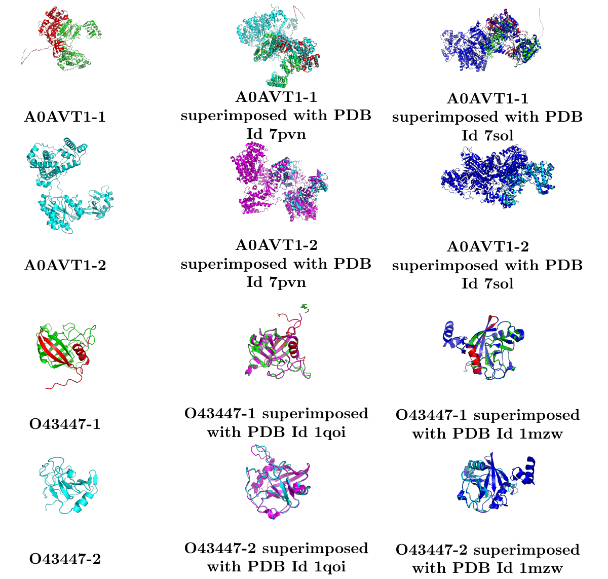
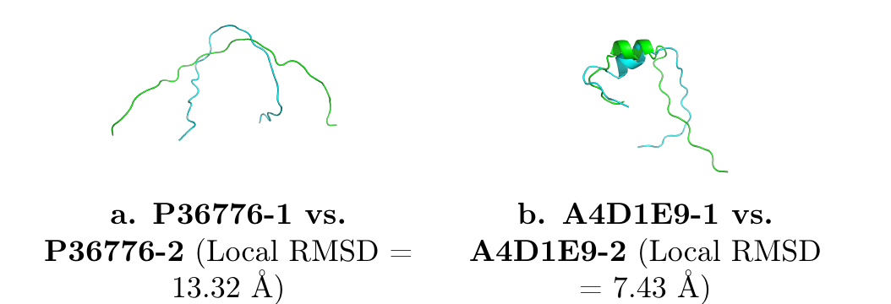

# Effect of Alternative Splicing on Protein Structure

**Master's thesis in Bioinformatics** · Universität des Saarlandes, Center for Bioinformatics · Chair of Computational Biology · submitted 1 August 2025

**Author:** Rija George  
**Supervisor:** Prof. Dr. Volkhard Helms · **Reviewers:** Prof. Dr. Volkhard Helms, Prof. Dr. Olga Kalinina


📄 **Full thesis:** [PDF (Google Drive)]((https://drive.google.com/file/d/1bIHjd5sa9Mb0kbFbmyhkKrL_Qa4AnszC/view?usp=share_link)) · archived on [Zenodo](https://doi.org/10.5281/zenodo.24052643)

---

## In one paragraph

Alternative splicing lets one gene produce several protein isoforms, but almost all experimentally solved structures show only the canonical form. This thesis asks: **how well does AlphaFold2 predict the structures of alternatively spliced isoforms, and how do splicing events change local and global protein conformation?** I built a pipeline that pulls isoform sequences from UniProt, matches them to experimental PDB structures deposited *after* AlphaFold2's training cut-off, predicts each isoform with AlphaFold2 (no templates), and scores the models globally and locally around splice junctions with RMSD and GDT_TS.

## Pipeline

```
UniProtKB/Swiss-Prot (human, var_seq)          23,251 AS entries → 10,582 human Swiss-Prot
        │  REST API, isoform extraction
        ▼
PDB mapping + deposition-date filter            ≥ 2 structures deposited after 30 Apr 2018
        │  RCSB API, multiprocessing, caching   → 2,366 proteins → 20 curated test proteins
        ▼
Global pairwise alignment                       Biopython PairwiseAligner, BLOSUM62,
        │                                       gap open −10 / extend −0.5
        ▼
AlphaFold2 structure prediction                 ColabFold / LocalColabFold, templates off,
        │                                       3 recycles, Amber relax, rank_001 model
        ▼
Structural evaluation                           pLDDT, pTM · global RMSD (PyMOL) ·
                                                local RMSD & local GDT_TS around splice sites
                                                (custom Python) · GDT_TS via LGA/AS2TS
```

The 20 test proteins were chosen to cover different splice-event types (deletion, insertion, substitution), lengths (4–474 residues affected) and positions (N-terminal, internal, C-terminal). See [`results/selected_proteins.csv`](results/selected_proteins.csv).

## Key findings

- **AlphaFold2 handles many isoforms well.** For UBA6, GNB5 and ME2, both isoforms were predicted with high confidence (average pLDDT > 90), with low RMSD and high GDT_TS. In these cases splicing did not disturb the overall fold.
- **Confidence can drop sharply for the alternative isoform**, even when that isoform is shorter. Two examples are PPIH (pLDDT 95.2 → 77.2) and GTPBP10 (80.5 → 67.9).
- **The largest divergence is local, at splice junctions.** LONP1 showed a local RMSD of 13.32 Å between isoforms in a region without regular secondary structure, and GTPBP10 showed 7.43 Å. Upstream and downstream windows often behaved differently.
- **High sequence similarity does not guarantee structural agreement.** For LONP1, the PDB entry with the better alignment score gave a far higher global RMSD, because of differences in experimental coverage and the flexibility of the region.
- **Region-specific metrics matter.** Local RMSD and local GDT_TS picked up changes that global scores averaged away.



<p align="center">
  <br>
  <em>AlphaFold2 models of UBA6 (A0AVT1) and PPIH (O43447) isoforms, alone and superimposed with experimental PDB structures. Splice regions are shown in red.</em>
</p>

<p align="center">
  <br>
  <em>Splice-adjacent regions of LONP1 and GTPBP10. Green: canonical isoform; cyan: alternative isoform.</em>
</p>

## Repository contents

| Path | What it is |
|---|---|
| [`thesis/`](thesis/) | Full thesis PDF |
| [`code/`](code/) | Python code for the pipeline stages as published in Chapter 4 (UniProt/PDB retrieval, pairwise alignment, local RMSD and local GDT_TS in PyMOL) |
| [`results/`](results/) | The 20-protein test set (Table 5.1) and AlphaFold2 confidence scores (Table 5.3) as CSV |
| [`figures/`](figures/) | Figures used in this README |

> **Note on the code:** the scripts reproduce the code listings from the thesis. Two small helper functions that the thesis does not print are marked `TODO`.

## Tools & skills

Python · Biopython · REST APIs (UniProt, RCSB PDB) · multiprocessing · AlphaFold2 (ColabFold, LocalColabFold) · PyMOL · NumPy · LGA / AS2TS · structural bioinformatics metrics (pLDDT, pTM, PAE, RMSD, GDT_TS)

## Outlook

The approach scales to more proteins, to non-human and tissue-specific isoforms, and could become a tool where a researcher enters a gene and gets predicted isoform structures with splice-site comparisons. Adding disorder predictions and functional annotation is a natural next step.

## Citation

```bibtex
@mastersthesis{george2025splicing,
  author = {George, Rija},
  title  = {Effect of Alternative Splicing on Protein Structure},
  school = {Universit{\"a}t des Saarlandes, Center for Bioinformatics},
  address = {Saarbr{\"u}cken, Germany},
  year   = {2025},
  month  = aug,
  type   = {Master's thesis}
}
```

## Acknowledgments

I thank Prof. Dr. Volkhard Helms for supervising this thesis at the Chair of Computational Biology, Prof. Dr. Olga Kalinina for reviewing it, and Debarshee Sengupta for his support and many helpful discussions. This work builds on an earlier thesis at the chair that benchmarked template-based modelling tools on splice isoforms.

## License

Thesis text, PDF and figures: © 2025 Rija George, all rights reserved. Code in `code/`: MIT License (see [LICENSE](LICENSE)).
